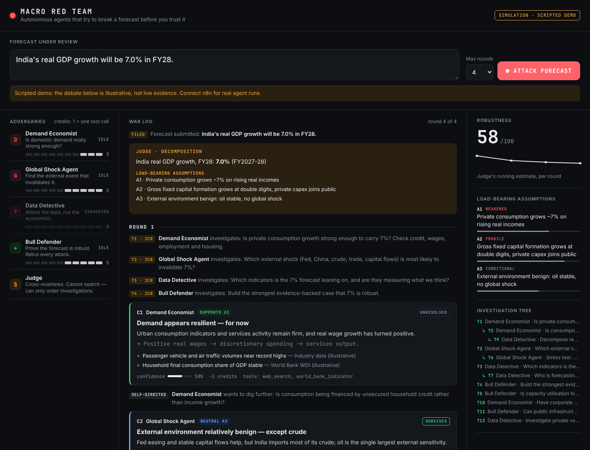
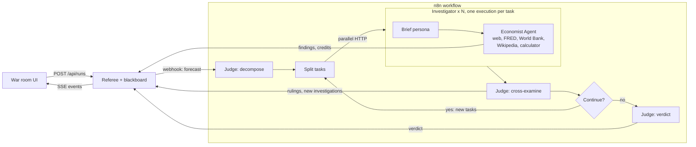
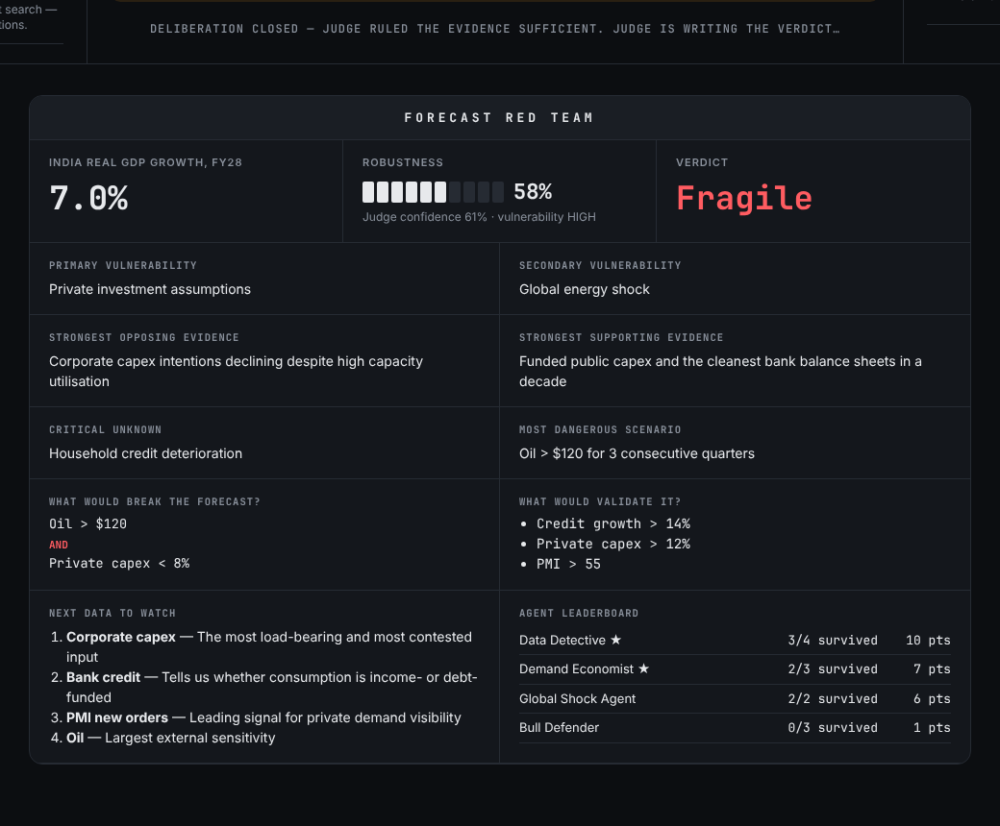

# Macro Red Team

**An autonomous multi-agent system that tries to break economic forecasts before decision-makers trust them.**

Give it a forecast, such as *"India's GDP will grow 7% in FY28"*, and press **Attack forecast**. Four adversarial agents investigate it. Each has its own budget and tools. They delegate to each other and challenge each other's claims. A judge cross-examines every round, decides what to investigate next, and finally delivers a verdict: robustness, primary vulnerability, what would break the forecast, and what data to watch.

The innovation isn't prediction. It's **adversarial economic reasoning**.



---

## How it is built

| Piece | Built with | Job |
|---|---|---|
| **Agents** (`n8n/`) | n8n AI Agent nodes + Claude | Decompose, investigate, delegate, cross-examine, decide, stop |
| **Referee / blackboard** (`app/referee.js`) | Node.js, zero dependencies | Shared evidence ledger, credit budgets, the rules of the game |
| **War room** (`app/public/`) | Vanilla HTML/CSS/JS, built with Claude Code | Streams the debate live over Server-Sent Events |



### Why this is agentic, not a pipeline

A Flask pipeline is `Input → Agent 1 → Agent 2 → Agent 3 → Output`. Here the **agents decide the control flow**:

| Capability | Where it lives |
|---|---|
| **Dynamic task creation** | The judge's `new_investigations` and each agent's `follow_ups` become next round's tasks (`Continue?` loops back to `Split Tasks`). |
| **Dynamic delegation** | An agent can hand a follow-up to another specialist ("Data Detective delegated to Historian"). It shows in the investigation tree. |
| **Dynamic tool selection** | Each investigator chooses among web search (Tavily), FRED, World Bank, Wikipedia and a calculator, or none. |
| **Budgets** | 10 credits per agent, where 1 credit = 1 tool call. The referee bills the calls an agent actually made, overspending eats future budget, and broke agents get their tasks rejected. |
| **Adversarial iteration** | `type: "challenge"` tasks aim one agent at another's claim (bull vs bear). Claims carry `challenges_claim`. |
| **Judge, not voting** | The judge can't search, only order investigations. It weighs evidence, source independence (the referee computes source concentration), causal validity, contradictions and missing information. |
| **Dynamic stopping** | The judge sets `sufficient`. The referee also stops on the round limit, exhausted budgets, or an empty queue, and forces a minimum of 2 rounds. |
| **Rewards** | The leaderboard scores agents by which of their arguments survived cross-examination. |

### Scope check: what happens with non-economic input

Before any agent is dispatched, the judge classifies the submission in the same call that decomposes it, so the check adds no extra LLM call:

| Judge says | Example | What happens |
|---|---|---|
| `forecast` | *"India GDP 7% FY28"*, *"Will the Fed cut 3 times?"*, *"Tesla hits $500"*, *"EVs reach 30% of car sales"* | Runs normally |
| `too_vague` | *"The economy will do well"* | Stops and offers a testable rewrite with a one-click **Attack the suggested forecast** |
| `not_a_forecast` | *"What is inflation?"*, *"hello"*, prompt-injection attempts | Stops; no agents run, no credits spent |
| `out_of_scope` | *"Argentina will win the World Cup"* | Stops with an explanation |

Genuine requests are protected in three ways:
- The judge is told that questions, terse fragments, forecasts without a horizon, company/market/sector forecasts, other languages, and events judged by their economic effect all count as forecasts, and to choose `forecast` when in doubt.
- The referee **fails open**: only those three explicit verdicts stop a run. A missing or garbled verdict runs normally.
- Every stop shows a **Run anyway** button, which skips the check.

`eval/scope-eval.mjs` replays 30 submissions through the exact production prompt and fails if any genuine forecast is rejected (see Development).

### The cast

| Agent | Mission | Rewarded for |
|---|---|---|
| Demand Economist | Is domestic demand strong enough? (consumption, credit, wages, jobs, housing, corporate capex intentions) | Demand arguments that survive |
| Global Shock Agent | Find the external event that invalidates it (Fed, China, crude, flows, FX) | External invalidators |
| Data Detective | Attack the data: base effects, inventories, government spending, revisions | Unreliable evidence |
| Bull Defender | Prove the forecast is robust, rebut attacks by claim id | Forecast surviving |
| **Judge** | Decompose, cross-examine, order investigations, decide when to stop, deliver the verdict | Correctly identifying which arguments survive |

---

## Quick start

### 1. Scripted demo (no keys, about 1 minute)

```bash
cd app && npm start          # Node 20+, no npm install needed
open http://localhost:3000   # press "Attack forecast"
```

Without `N8N_WEBHOOK_URL` the server replays a scripted India-FY28 debate through the same referee calls n8n makes. That exercises budgets, delegation, challenges, judge rulings and the verdict. The evidence in this mode is illustrative and labelled as such. Add `?speed=4` to the URL to replay faster.

### 2. Live agents with n8n

You need one LLM API key from any provider below, plus optionally a [Tavily](https://tavily.com/) key (web search) and a [FRED](https://fred.stlouisfed.org/docs/api/api_key.html) key. World Bank, Wikipedia and the calculator need no key.

| Provider | Workflow file to import | Get a key | Default model |
|---|---|---|---|
| Anthropic Claude (recommended) | `n8n/macro-red-team.workflow.json` | [platform.claude.com](https://platform.claude.com) → Settings → API Keys | `claude-opus-5-5` |
| Google Gemini | `n8n/macro-red-team.gemini.workflow.json` | [aistudio.google.com](https://aistudio.google.com) → Get API key | `models/gemini-3-flash-preview` |
| OpenAI | `n8n/macro-red-team.openai.workflow.json` | [platform.openai.com](https://platform.openai.com) → API keys | `gpt-5-mini` |
| OpenRouter (one key, many models) | `n8n/macro-red-team.openrouter.workflow.json` | [openrouter.ai](https://openrouter.ai) → Keys | `openai/gpt-4.1-mini` |

The prompts, tools, loop and scope check are identical in all four files; only the four model nodes differ. To use a different model, pick one from the model dropdown in each model node, which lists what your key can access, or regenerate the file (see below). Rate limits matter: up to 8 agents call the model at once, so a low-tier or free key may return "429 Too Many Requests". If it does, lower `maxTasksPerRound` in `app/referee.js` or upgrade the tier.

```bash
docker compose up -d     # n8n on :5678, war room on :3000
```

1. Open n8n at http://localhost:5678 and create the owner account.
2. **Workflows → Import from File** → the workflow file for your provider (table above).
3. Connect credentials. The sticky note on the canvas lists them:
   - Your LLM key on the four model nodes (`Claude:`, `Gemini:`, `OpenAI:` or `OpenRouter:`); create it once and reuse it on the other three
   - **Tavily API (Bearer)**: Header Auth, name `Authorization`, value `Bearer tvly-…`
   - **FRED API key**: Query Auth, name `api_key`, value = your key

   You don't have a key? Delete that tool node; the agents adapt.
4. **Publish** the workflow. It must be published, because investigations fan out through the production webhook (`/webhook/macro-red-team-investigate`). The `webhook-test` URLs only accept one call at a time.
5. Open http://localhost:3000. The badge reads **n8n agents connected**. Attack.

<details>
<summary>Without Docker</summary>

```bash
npx n8n@2.44.6                       # n8n 2.x needs Node 24+
# import + publish the workflow as above, then:
cd app
N8N_WEBHOOK_URL=http://localhost:5678/webhook/macro-red-team \
PUBLIC_API_BASE=http://localhost:3000 \
npm start
```

`PUBLIC_API_BASE` is the address n8n uses to call the referee back. Use `http://app:3000` inside compose, or a tunnel URL if n8n runs in the cloud. See `.env.example`.
</details>

---

## The n8n workflow



**Orchestrator** (webhook `/macro-red-team`):

`Run Context → Judge: Decompose Forecast → Referee: Open Round 1 → Split Tasks → Dispatch Investigations → Collect Round → Referee: Close Round → Judge: Cross-Examine → Referee: Post Rulings → Continue?` ↺, then `Judge: Verdict → Referee: Publish Verdict`.

**Investigator** (webhook `/macro-red-team-investigate`, one execution per task):

`Task Context → Brief the Agent (persona + live blackboard) → Economist Agent (+ tools, structured output) → Referee: Submit Finding`.

`Dispatch Investigations` is an HTTP Request node, which sends all items concurrently, so every agent investigates in parallel. Each investigation is a separate execution on purpose. When one n8n 2.x Agent node processes several items and any of them calls a tool, the node re-runs every item on the next pass. That re-calls Claude for agents that had already finished. One execution per task avoids that, and also lets `maxIterations` be set per task (credits + 2).

The workflow JSON is generated, so edit the sources rather than the JSON:

```bash
node n8n/build-workflow.mjs                                  # Claude, claude-opus-5-5
node n8n/build-workflow.mjs --model claude-sonnet-5-5        # Claude, cheaper runs
node n8n/build-workflow.mjs --provider gemini --model models/gemini-3-pro-preview
node n8n/build-workflow.mjs --provider openai --model gpt-5
node n8n/build-workflow.mjs --all                            # regenerate all four files
```

Model IDs for other providers are passed through as-is, so use the exact ID the provider lists.

- Personas, judge prompts and output schemas: `n8n/prompts.mjs`
- Nodes, tools and wiring: `n8n/build-workflow.mjs`
- Game rules (credits, rounds, tasks per round): `RULES` in `app/referee.js`

The Claude nodes use adaptive thinking (effort `medium` for investigators, `high` for the judge) and send no sampling parameters. Current Claude models reject `temperature` and disabled thinking, so don't add them back in the node options. The OpenAI nodes map the same split onto `reasoningEffort`.

**Cost.** A 4-round run is roughly 15–25 investigator runs plus 5–6 judge calls, whichever provider you use. Try a few runs with a cheaper model before a live demo.

### Referee API (what n8n calls)

Every callback is authenticated with the per-run `x-run-token` header, sent to n8n in the start webhook.

| Method & path | Called by | Does |
|---|---|---|
| `POST /api/runs/:id/plan` | Judge: Decompose | Stores assumptions, queues opening tasks, opens round 1 |
| `POST /api/runs/:id/findings` | Investigator | Bills credits from intermediate steps, posts the claim, queues follow-ups and delegations |
| `POST /api/runs/:id/rounds/close` | Orchestrator | Releases credits of crashed investigators, returns the blackboard digest |
| `POST /api/runs/:id/rulings` | Judge: Cross-Examine | Applies rulings, queues new investigations, decides continue or stop, opens the next round |
| `GET /api/runs/:id/blackboard` | Orchestrator | Final digest for the verdict |
| `POST /api/runs/:id/verdict` | Judge: Verdict | Publishes the verdict and leaderboard |

The UI uses `POST /api/runs`, `GET /api/runs/:id` and `GET /api/runs/:id/stream` (SSE).

---

## Extending the front end with Claude Code

The war room is plain HTML/CSS/JS with no build step, so Claude Code can change it and you see the result on refresh. Run `claude` in the repo and ask for things like:

- *"Add a force-directed graph of claims and challenges (claim → challenged claim) next to the war log, using d3 from a CDN."*
- *"Add an export button that downloads the verdict and all surviving claims as Markdown."*
- *"Persist runs to SQLite so they survive a server restart, and add a run history sidebar."*
- *"Add a new agent 'Policy Analyst' focused on fiscal and monetary policy: persona in n8n/prompts.mjs, roster in app/referee.js, then rebuild the workflow."*

Every event the UI renders is listed in `HANDLERS` in `app/public/app.js`. All agent text is rendered through `textContent`, because it is untrusted LLM output.

---

## Development

```bash
cd app && npm test     # referee rules, budgets, delegation, stopping, scope gate, simulator
```

Check the scope gate against real Claude whenever you change the judge prompt:

```bash
cd eval && npm install
ANTHROPIC_API_KEY=sk-ant-... npm run scope                  # 30 cases, about 30 judge calls
npm run scope -- --model claude-sonnet-5-5 --only genuine   # cheaper, genuine forecasts only
```

The script exits non-zero if any genuine forecast is rejected. Add your own real-world phrasings to `CASES` in the script. The eval enables server-side refusal fallbacks (`fallbacks: "default"`), so a safety decline is retried on another model rather than counted as a rejection.

The Claude and Gemini workflows were verified end-to-end on n8n 2.44.6 against mocked model APIs (via the credential's base URL) and mocked data APIs. The OpenAI and OpenRouter files are built from the same template but haven't been run. The test covered a full run: decomposition, parallel investigators calling tools, per-call billing, a delegated follow-up, a judge-ordered challenge, the stopping decision and the verdict.

**Limitations:**
- Runs live in memory, so restarting the server forgets them.
- If an investigator crashes, its credits are released when the round closes, and the judge carries on without that finding.
